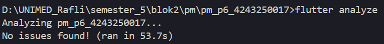
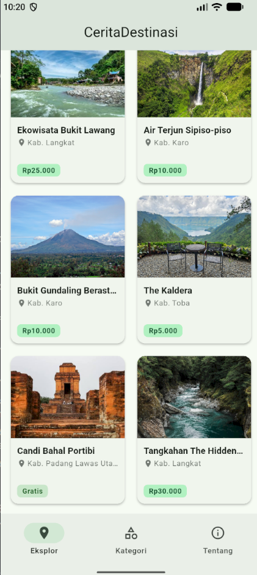
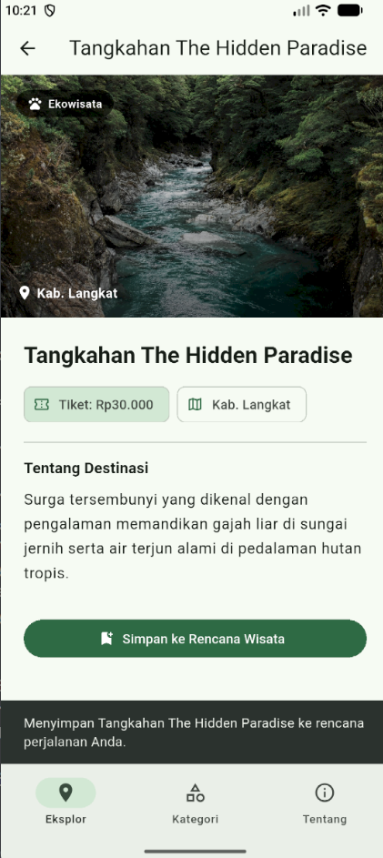
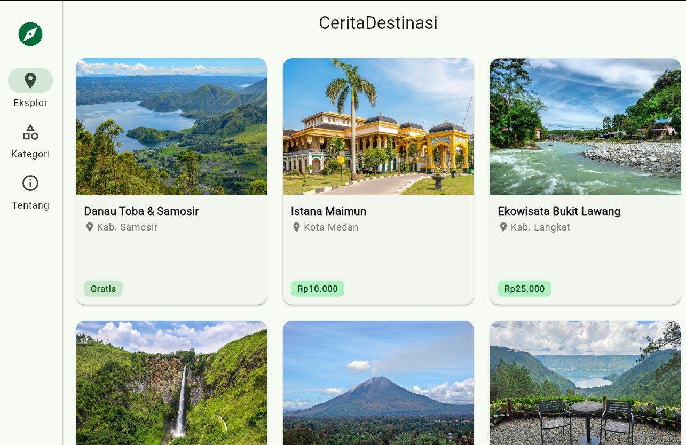
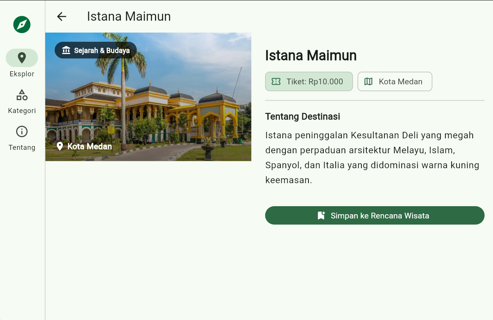
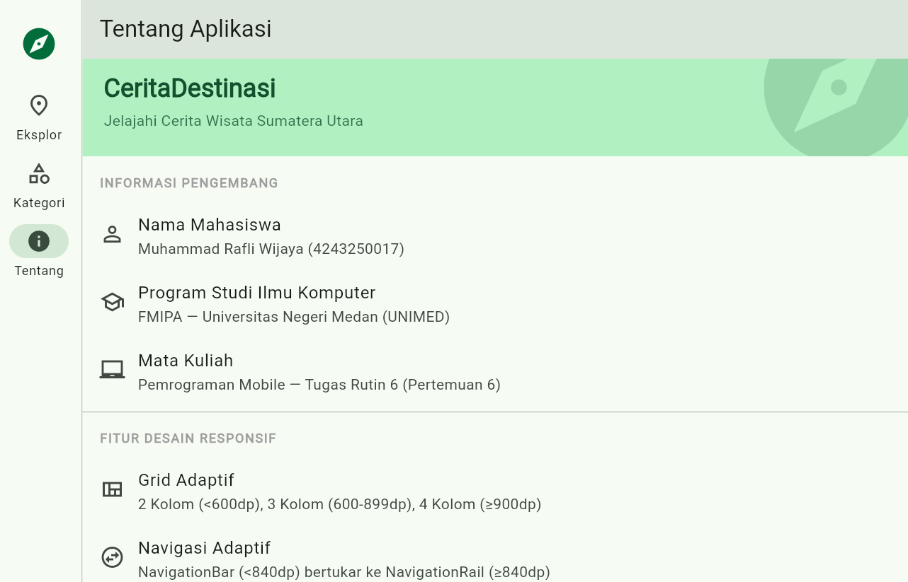

### A. Identitas
- Nama: Muhammad Rafli Wijaya
- NIM: 4243250017
- Kelas: PSIK 24D
- Mata Kuliah: Pemrograman Mobile

### B. Tangkapan Layar
- Flutter Analyze

- Mode Mobile Menu Kategori

- Mode Mobile Menu Detail

- Mode Tablet Menu Ekplorasi

- Mode Tablet Menu Detail

- Mode Tablet Tentang

### C. Penjelasan Keputusan Responsif
### 1. Tingkat Aplikasi (Global) menggunakan MediaQuery
Pada KerangkaNavigasi, saya menggunakan MediaQuery.sizeOf(context).width dengan batas ambang (breakpoint) 840 dp:
if (lebarLayar >= 840) {
  return Scaffold(body: Row(children: [NavigationRail(...), Expanded(child: shell)]));
}
return Scaffold(body: shell, bottomNavigationBar: NavigationBar(...));

Alasan: MediaQuery ideal untuk mengukur layar secara keseluruhan. Pada hp/mobile (< 840 dp), menu ditaruh di bawah (NavigationBar) agar mudah dijangkau ibu jari. Pada tablet/desktop (≥ 840 dp), menu otomatis pindah ke samping (NavigationRail) agar tidak memotong ruang tinggi layar.

### 2. Tingkat Komponen (Lokal) menggunakan LayoutBuilder
Untuk isi halaman, saya memilih LayoutBuilder karena membaca batasan ruang widget itu sendiri (constraints.maxWidth), bukan ukuran layar:
- Halaman Daftar (halaman_destinasi.dart):
Menentukan jumlah kolom grid secara fleksibel:
final kolom = switch (constraints.maxWidth) {
  < 600 => 2, // hp
  < 900 => 3, // tablet
  _ => 4, // layar luas/desktop
};

- Halaman Detail (halaman_detail.dart):
Menggunakan batas 720 dp. Layar sempit menyusun foto dan deskripsi secara vertikal (ListView), sedangkan layar lebar menyusunnya berdampingan (Row).

### D. Pernyataan Penggunaan AI
Saya menggunakan template pratikum dari modul pertemuan 6 untuk membangun aplikasi CeritaDestinasi ini (ada di repo pm-p6-pratikum-4243250017), lalu saya tambahkan dan ubah sesuai kebutuhan aplikasi seperti objek dari produk menjadi destinasi, menambah field kabupatenKota, harga tiket, gambar dll. Kemudian saya gunakan AI untuk membantu saya menambahkan hal-hal yg belum ada di template sebelumnya seperti gambar yg dibungkus stack dan menambah tab baru yaitu kategori.
